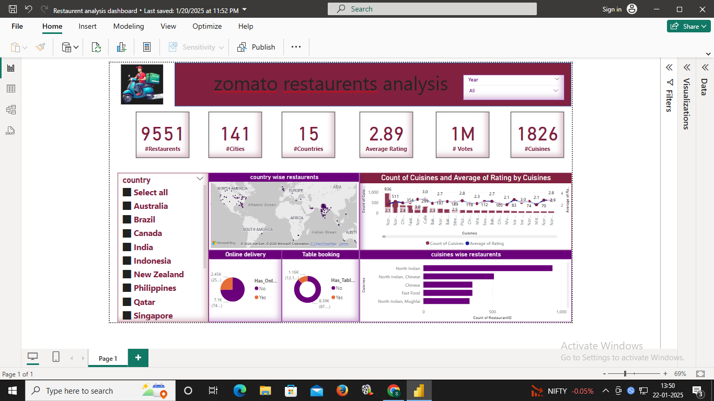
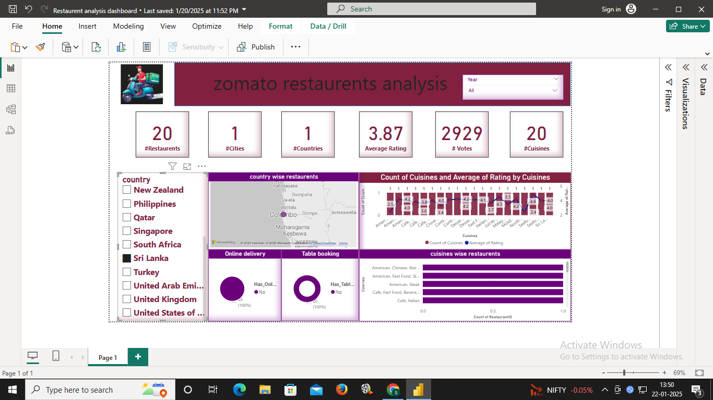

# Restaurant Analysis Dashboard (Power BI)

An interactive Power BI dashboard analysing **9,551 restaurants across 15 countries and 141 cities** from a public Zomato restaurant dataset. It compares ratings, cuisines, pricing and services globally and by country.

## Key findings
- **Cuisine ratings vary widely.** Among primary cuisines with at least 30 restaurants, the highest-rated averages 4.12 and the lowest 2.25, a gap of more than 20%.
- **Services go with higher ratings.** Restaurants with online delivery average 3.29 versus 2.75 without. Restaurants with table booking average 3.48 versus 2.81 without.
- **Price tracks rating.** Average rating rises from 2.38 (price range 1) to 3.84 (price range 4).
- **The data is India-heavy.** India accounts for 8,652 of the 9,551 restaurants (about 91%), so global comparisons lean on small samples outside India.

## What the dashboard includes
- Global overview cards: total restaurants, cities, countries, cuisines, average rating, total votes
- Map of restaurant distribution by country
- Cuisine count and average rating
- Online delivery and table booking comparison
- Country-wise drill-down

## Tools
- **Excel / Power Query:** cleaning and preparing the data, including splitting multi-cuisine entries into separate columns
- **Power BI and DAX:** measures, map and card visuals, interactive filters

## Files
| File | Description |
|---|---|
| `Restaurent analysis dashboard.pbix` | Power BI report |
| `restaurant_data_cl.xlsx` | Cleaned dataset |
| `dashboard1.png`, `dashboard2.png` | Dashboard screenshots |

## Limitations
- Ratings are customer-submitted and not weighted by number of votes.
- Primary cuisine is taken from the first listed cuisine only.
- Countries other than India have small samples, so treat country comparisons with care.
